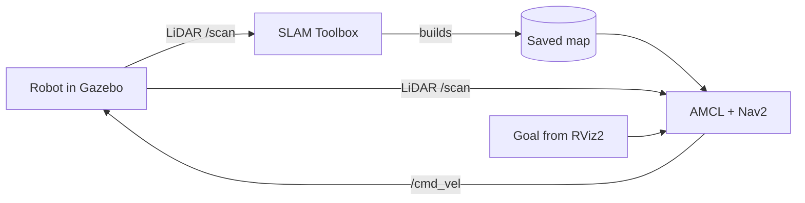

# 🤖 Arena Navigator ROS 2

A TurtleBot3 robot that **draws a map of a room by itself, then drives around that room on its own.**

I built this for the Antropi Robotics Software Intern assignment. The robot lives in a custom Gazebo arena. First I drive it around by keyboard while it builds a map with its LiDAR (SLAM Toolbox). Then I save the map, and Nav2 takes over: I click a goal in RViz2, and the robot plans a path and avoids obstacles to get there.

**Tech used:** ROS 2 Humble · Ubuntu 22.04 · Gazebo Classic · TurtleBot3 Burger · SLAM Toolbox · Nav2 · RViz2

---

## 🎬 Demo

▶️ **[Watch the demo video](Shivam_Antropi_Assignment_Videos.webm)** (click, then press play on the GitHub page)

| Mapping and navigation | Robot in the arena |
|---|---|
|  |  |

---

## 🧠 How it works (quick revision)

Think of it in 3 simple steps:

1. **Explore and map:** the robot has a LiDAR (a spinning laser that measures distances). SLAM Toolbox uses those distances to build a 2D map while I drive.
2. **Save the map:** the map is stored as two files, `obstacle_arena.yaml` and `obstacle_arena.pgm`.
3. **Navigate:** Nav2 loads the saved map, works out where the robot is (AMCL), plans a path to the goal, and steers the robot along it while dodging obstacles.

| Term | What it means |
|---|---|
| **Topic** | A named channel nodes use to send data, e.g. `/scan` (LiDAR), `/odom` (movement), `/cmd_vel` (speed commands) |
| **TF** | The tree of coordinate frames: `map → odom → base_footprint → base_link` |
| **SLAM** | Building a map and finding your position at the same time |
| **Occupancy grid** | The map: each cell is free, occupied or unknown |
| **AMCL** | Finds the robot's position on a known map using LiDAR |
| **Costmap** | A map of "how dangerous is each cell"; obstacles get a safety margin around them |
| **Global planner** | Plans the whole route from start to goal |
| **Local planner** | Follows the route and avoids new obstacles close by |
| **Behavior tree / recovery** | Decides what to do when stuck (spin, back up, replan) |
| **`use_sim_time`** | Makes every node follow Gazebo's clock instead of the real clock |



---

## 🏟️ The arena

A 10 m × 10 m room with:
- 4 outer walls
- 6 rectangular boxes
- 1 cylinder
- 1 triangle
- 1 half-height wall
- a narrow gap (about 0.7 m) next to the east wall

The robot always starts at the green square at (-4, -4).

---

## 📁 What's inside

```
Arena-Navigator-ROS2/
├── src/tb3_autonomous/
│   ├── launch/    simulation · mapping · navigation · full_demo
│   ├── worlds/    obstacle_arena.world      (the arena)
│   ├── config/    slam_params.yaml · nav2_params.yaml · RViz configs
│   ├── maps/      obstacle_arena.yaml / .pgm (my saved map)
│   └── scripts/   save_map.sh · check_system.sh · demo_goals.py
├── Assignment image 1.png / Assignment image 2.png
├── Shivam_Antropi_Assignment_Videos.webm
└── README.md
```

---

## ⚙️ Setup

```bash
sudo apt update && sudo apt install -y ros-humble-desktop ros-humble-gazebo-ros-pkgs \
  ros-humble-turtlebot3 ros-humble-turtlebot3-simulations ros-humble-turtlebot3-teleop \
  ros-humble-slam-toolbox ros-humble-navigation2 ros-humble-nav2-bringup \
  ros-humble-nav2-simple-commander python3-colcon-common-extensions

echo 'export TURTLEBOT3_MODEL=burger' >> ~/.bashrc && source ~/.bashrc

git clone https://github.com/shiavm17/Arena-Navigator-ROS2.git ~/tb3_autonomous_ws
cd ~/tb3_autonomous_ws
chmod +x src/tb3_autonomous/scripts/*
colcon build --symlink-install
source install/setup.bash
```

In every new terminal, run this first:
```bash
source /opt/ros/humble/setup.bash && source ~/tb3_autonomous_ws/install/setup.bash
```

---

## 🗺️ Part 1: Make the map

**Terminal 1:** start Gazebo
```bash
ros2 launch tb3_autonomous simulation.launch.py
```
**Terminal 2:** start SLAM and RViz2
```bash
ros2 launch tb3_autonomous mapping.launch.py
```
**Terminal 3:** drive the robot (`w` forward, `x` back, `a` left, `d` right, `s` stop)
```bash
ros2 run turtlebot3_teleop teleop_keyboard
```
Drive slowly. Go along all four walls first, then around every obstacle, and through the narrow gap, until the map in RViz looks complete.

**Terminal 4:** save the map (stop teleop first)
```bash
./src/tb3_autonomous/scripts/save_map.sh obstacle_arena
```
This creates `obstacle_arena.yaml` and `obstacle_arena.pgm` in `src/tb3_autonomous/maps/`.

---

## 🧭 Part 2: Let the robot navigate

Close all terminals, then open new ones.

**Terminal 1:** Gazebo
```bash
ros2 launch tb3_autonomous simulation.launch.py
```
**Terminal 2:** Nav2 with the saved map and RViz2 (wait about 10 seconds after Terminal 1)
```bash
ros2 launch tb3_autonomous navigation.launch.py \
  map:=$HOME/tb3_autonomous_ws/src/tb3_autonomous/maps/obstacle_arena.yaml
```

In RViz2:
1. Click **2D Pose Estimate**, then click and drag on the robot (only needed if the green particles are not on the robot).
2. Click **Nav2 Goal** (or **2D Goal Pose**), click a free spot on the map and drag to choose the direction.
3. Watch the robot drive there. The green line is the global path and the orange line is the local path.

Optional: let a script send 5 goals one after another
```bash
ros2 run tb3_autonomous demo_goals.py
```

---

## ✅ Checklist I used to test

- [ ] Workspace builds with `colcon build`
- [ ] Gazebo shows the arena and the robot
- [ ] `/scan`, `/odom`, `/tf`, `/cmd_vel` topics exist
- [ ] Map grows while I drive
- [ ] Map saved as `.yaml` and `.pgm`
- [ ] Saved map shows up in RViz in navigation mode
- [ ] `ros2 lifecycle get /amcl` and `/map_server` say `active`
- [ ] Robot reaches several goals and avoids the obstacles

---

## 🛠️ If something goes wrong

| Problem | Try this |
|---|---|
| Map not showing in RViz | Use the full `map:=...yaml` path; set Fixed Frame to `map`; set the Map display Durability to `Transient Local` |
| "Could not transform" errors | Make sure only one Gazebo is running, then set **2D Pose Estimate** |
| Robot won't move | Close the teleop terminal; check `ros2 topic info /cmd_vel` |
| Gazebo freezes | `killall -9 gzserver gzclient` and launch again |
| Nav2 not starting | `ros2 lifecycle get /map_server`; check the map path |
| Quick health check | `./src/tb3_autonomous/scripts/check_system.sh` |

---

## ⚠️ Limitations

- Works with ROS 2 Humble and Gazebo Classic only.
- Settings are tuned for the TurtleBot3 Burger.
- The robot's start pose (-4, -4) is set in both the spawn and `nav2_params.yaml`; change both together.
- The map was made by me driving the robot manually in simulation.

## 📄 License
Apache-2.0

**Author:** Shivam Chaturvedi
