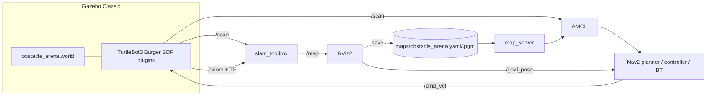

# TurtleBot3 Autonomous Navigation: Gazebo + SLAM Toolbox + Nav2

**Repo description:** ROS 2 Humble project: TurtleBot3 Burger explores a custom 10×10 m Gazebo arena, builds a map with SLAM Toolbox, then navigates autonomously with Nav2 and RViz2 goals.

> **Status:** All files were written and syntax-checked (XML, YAML, Python, bash) but **have not been run against a live ROS 2/Gazebo install** by the author of this scaffold. Work through the validation checklist below on your Ubuntu 22.04 machine and fix any local differences (see Troubleshooting).

## 1. Stack and compatibility
| Component | Choice |
|---|---|
| OS / ROS | Ubuntu 22.04, ROS 2 Humble |
| Simulator | **Gazebo Classic 11** (`gazebo_ros_pkgs`) – the TurtleBot3 Humble simulation targets this; do not mix with `ros_gz` / Ignition |
| Robot | TurtleBot3 **Burger** (`TURTLEBOT3_MODEL=burger`) |
| Mapping | `slam_toolbox` (online async) |
| Navigation | `nav2_bringup` (map_server, AMCL, NavFn planner, DWB controller, BT navigator, behaviors) |

## 2. Architecture


## 3. Directory tree
```
tb3_autonomous_ws/
├── .gitignore
└── src/tb3_autonomous/
    ├── package.xml  CMakeLists.txt  README.md  LICENSE
    ├── launch/  simulation.launch.py  mapping.launch.py  navigation.launch.py  full_demo.launch.py
    ├── worlds/  obstacle_arena.world
    ├── maps/    .gitkeep   (your generated obstacle_arena.yaml/.pgm go here)
    ├── config/  slam_params.yaml  nav2_params.yaml  rviz_mapping.rviz  rviz_navigation.rviz
    └── scripts/ save_map.sh  check_system.sh  demo_goals.py
```

## 4. The arena (`worlds/obstacle_arena.world`)
Inner area 10 × 10 m (walls 1.0 m tall, 0.2 m thick). All objects have collision + visual geometry.

| Object | Pose (x, y) | Size |
|---|---|---|
| box_1…box_6 | (-2,-2) (1.5,-3) (3,0) (-3,2) (0,2.8) (4,-2.2) | 0.4–1.2 m, 0.8 m tall |
| cylinder_1 | (0, 0) | r 0.35 m |
| triangle_1 | (2.5, 3) | equilateral, side 1.0 m |
| half_wall | (1.8,-1) | 1.6 × 0.2 × **0.5 m** (half height) |
| Narrow passage | box_6 ↔ east wall | ≈ 0.7 m gap |

Floor markings (visual only): green = start (-4,-4); purple = goals A (3,-4), B (3.8,3.8), C (-3.5,3.5), D (0,-4), E (-3.5,0). Burger spawns at **(-4,-4), yaw 0** in both mapping and navigation.

## 5. Install
```bash
sudo apt update
sudo apt install -y ros-humble-desktop ros-humble-gazebo-ros-pkgs \
  ros-humble-turtlebot3 ros-humble-turtlebot3-simulations ros-humble-turtlebot3-teleop \
  ros-humble-slam-toolbox ros-humble-navigation2 ros-humble-nav2-bringup \
  ros-humble-nav2-simple-commander python3-colcon-common-extensions python3-rosdep
echo 'export TURTLEBOT3_MODEL=burger' >> ~/.bashrc
echo 'source /opt/ros/humble/setup.bash' >> ~/.bashrc
source ~/.bashrc
```

## 6. Build
```bash
cd ~/tb3_autonomous_ws
sudo rosdep init 2>/dev/null || true; rosdep update
rosdep install --from-paths src --ignore-src -r -y
colcon build --symlink-install
source install/setup.bash
```
(Every new terminal: `source /opt/ros/humble/setup.bash && source ~/tb3_autonomous_ws/install/setup.bash`.)

## 7. Workflow

**Terminal 1 – simulation**
```bash
ros2 launch tb3_autonomous simulation.launch.py          # add gui:=false for headless
```
**Terminal 2 – SLAM + RViz2**
```bash
ros2 launch tb3_autonomous mapping.launch.py
```
**Terminal 3 – teleoperate** (keep this terminal focused; `w/x` forward/back, `a/d` rotate, `s` stop)
```bash
ros2 run turtlebot3_teleop teleop_keyboard
```
Coverage tips: drive slowly (≤0.15 m/s, rotate gently), first trace the walls counter-clockwise, then pass on both sides of every obstacle, go through the 0.7 m gap by box_6, and revisit the start so loop closure fires. Stop when RViz shows closed outlines of all obstacles and no large grey areas.

**Terminal 4 – save the map** (stop teleop first, leave SLAM running)
```bash
~/tb3_autonomous_ws/src/tb3_autonomous/scripts/save_map.sh obstacle_arena
# equivalent manual command:
# ros2 run nav2_map_server map_saver_cli -f ~/tb3_autonomous_ws/src/tb3_autonomous/maps/obstacle_arena --ros-args -p use_sim_time:=true
ls ~/tb3_autonomous_ws/src/tb3_autonomous/maps     # obstacle_arena.yaml  obstacle_arena.pgm
```
Stop everything (Ctrl+C in terminals 1–3).

**Autonomous navigation** (fresh terminals)
```bash
# Terminal 1
ros2 launch tb3_autonomous simulation.launch.py
# Terminal 2  (loads maps/obstacle_arena.yaml; AMCL starts at the spawn pose)
ros2 launch tb3_autonomous navigation.launch.py
# Custom map:  ros2 launch tb3_autonomous navigation.launch.py map:=/abs/path/map.yaml
```
In RViz2: if the particle cloud is not on the robot, click **2D Pose Estimate** and drag at the robot's position/heading. Then click **Nav2 Goal** (the toolbar goal tool), click a target on the map and drag to set heading. Watch the green global plan, orange local plan, costmaps and footprint. Send several goals (A–E).

Scripted goals (optional): `ros2 run tb3_autonomous demo_goals.py`

One-command alternatives: `ros2 launch tb3_autonomous full_demo.launch.py mode:=mapping` / `mode:=navigation`.

## 8. Inspection commands
```bash
ros2 topic list                       # expect /scan /odom /tf /tf_static /cmd_vel /clock /map
ros2 topic echo /scan --once | head -30
ros2 topic hz /scan                   # ~5 Hz
ros2 topic echo /odom --once
ros2 run tf2_tools view_frames        # frames.pdf: map->odom->base_footprint->base_link->base_scan
ros2 run tf2_ros tf2_echo map base_footprint
ros2 lifecycle get /amcl              # and /map_server /planner_server /controller_server /bt_navigator
ros2 topic pub --once /cmd_vel geometry_msgs/msg/Twist "{linear: {x: 0.1}}"
~/tb3_autonomous_ws/src/tb3_autonomous/scripts/check_system.sh
```

## 9. Validation checklist
- [ ] `colcon build` succeeds, `ros2 pkg prefix tb3_autonomous` resolves
- [ ] Gazebo shows arena with all obstacles, robot at the green square
- [ ] `/scan`, `/odom`, `/tf`, `/tf_static`, `/cmd_vel`, `/clock` present; `/scan` ~5 Hz
- [ ] `odom → base_footprint` TF present; RViz shows red scan points on obstacle edges
- [ ] Mapping: `/map` grows as robot moves
- [ ] Map saved: `.yaml` + `.pgm` exist; opening the `.pgm` shows the arena
- [ ] Map loads in navigation launch (static map visible in RViz)
- [ ] AMCL particles converge on robot; `map → odom` TF present
- [ ] All Nav2 lifecycle nodes `active`
- [ ] ≥3 goals reached; global/local plans visible
- [ ] Place a new box in Gazebo on the path → robot replans / recovers (spin, backup)

## 10. Troubleshooting
| Symptom | Fix |
|---|---|
| `Package 'turtlebot3_gazebo' not found` | Install section 5; `source /opt/ros/humble/setup.bash` |
| Gazebo black screen / hangs on start | `killall gzserver gzclient`; first start downloads/caches models; `GAZEBO_MODEL_DATABASE_URI` is already blanked by the launch file |
| Gazebo plugin errors (`libgazebo_ros_*.so`) | Ensure `ros-humble-gazebo-ros-pkgs`; do not mix with Ignition/`ros_gz` packages |
| Robot doesn't spawn | `echo $TURTLEBOT3_MODEL` must be `burger`; spawn needs gzserver up (re-run launch); check `spawn_entity` log |
| Empty `/scan` | `ros2 topic echo /scan --once`; check robot not inside an obstacle; verify RViz scan QoS is *Best Effort* |
| `Could not transform` / missing TF | Use `check_system.sh`; all nodes need `use_sim_time:=true`; make sure only ONE simulation is running |
| Clock issues | `ros2 topic echo /clock --once` must tick; every node `use_sim_time: true` |
| Map not updating | Robot must move >0.2 m / rotate >0.2 rad between updates; update interval is 2 s; confirm `/scan` and `odom` TF |
| Map not found on navigation | Use `map:=/absolute/path/obstacle_arena.yaml`; confirm `image:` line in the yaml resolves next to it |
| AMCL fails to localize | Robot must spawn at the same pose as mapping (-4,-4,0); otherwise use *2D Pose Estimate*; rotate the robot in place via teleop |
| Nav2 nodes stay inactive | `ros2 lifecycle get /map_server`; usually map path wrong or no `/scan`/TF. Read the `lifecycle_manager` log |
| Planner/controller failures | Goal on grey/occupied cell; set goals on free space; clear costmaps: `ros2 service call /global_costmap/clear_entirely_global_costmap nav2_msgs/srv/ClearEntireCostmap` |
| Robot ignores `/cmd_vel` | `ros2 topic info /cmd_vel`; Humble Nav2 publishes `cmd_vel` via velocity_smoother to `/cmd_vel`; check only one publisher conflicts (stop teleop) |

## 11. Recording a 1–2 minute demo
Layout: Gazebo window left, RViz2 right (`kazam`, OBS or `ffmpeg -f x11grab`). Milestones: (1) arena + robot, 0:00 · (2) teleop mapping, map growing, 0:10 · (3) `save_map.sh` + `ls maps/`, 0:45 · (4) restart with `navigation.launch.py`, AMCL particles, 0:55 · (5) three Nav2 goals, one passing the half-wall and the narrow passage, 1:05–1:50. Use `gui` default and speed up mapping in post if needed. Don't commit videos (link them).

## 12. Known limitations
- Not executed by the scaffold author; parameters follow Humble Nav2 defaults for Burger and may need tuning.
- Map accuracy depends on how carefully you drive; the repo ships no prebuilt map; generate your own (section 7) and commit `maps/obstacle_arena.*` labelled "generated by SLAM Toolbox from simulated LiDAR".
- Gazebo Classic only (Humble). For Jazzy/Gazebo Harmonic, the simulation launch and bridges must be redone.
- AMCL initial pose is hard-coded to the spawn pose in `nav2_params.yaml`; change both together.

## 13. Acceptance checklist
| Requirement | Where |
|---|---|
| Custom Gazebo world: walls, boxes, triangle, cylinder, half-wall, passages | `worlds/obstacle_arena.world` |
| TurtleBot3 + LiDAR in arena | `simulation.launch.py` |
| Teleop + SLAM Toolbox mapping, live RViz map | `mapping.launch.py`, `slam_params.yaml`, `rviz_mapping.rviz` |
| Map saved & reloaded | `save_map.sh`, `navigation.launch.py` |
| Nav2 with AMCL, costmaps, planner, controller, recoveries | `nav2_params.yaml` |
| RViz goals, plans, costmaps | `rviz_navigation.rviz`, `demo_goals.py` |
| Reproducible, relative paths, GitHub-ready | package-share paths, `.gitignore`, README |
